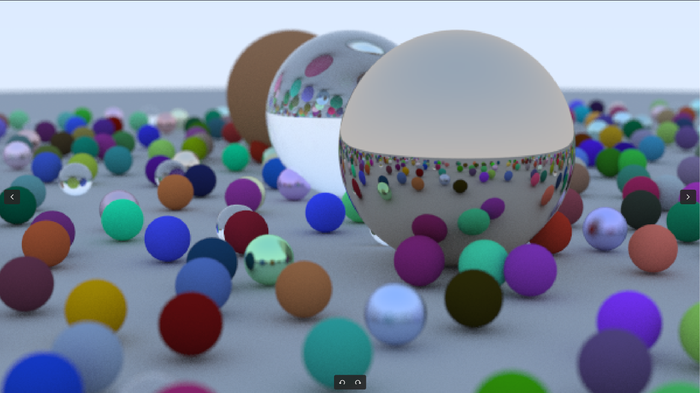

<h1 align="center">RAY TRACER</h1>

A **ray tracer** is a computer graphics rendering technique that simulates the behavior of light to generate realistic images of a 3D scene. By tracing rays through a virtual camera and calculating their interactions with objects and materials, ray tracing can simulate effects such as reflections, refractions, shadows, and depth of field.

This project implements a **CPU-based ray tracer in C++** that renders a 3D scene composed of spheres with different material properties. It supports diffuse surfaces that scatter light, metallic surfaces that produce reflections, and dielectric materials that simulate transparent objects such as glass through reflection and refraction. The renderer uses recursive ray tracing to simulate multiple light interactions, multisample antialiasing to reduce jagged edges, and depth-of-field effects to simulate camera focus and background blur.

The scene and camera parameters can be configured to experiment with object placement, material properties, image quality, and camera behavior. The rendered output is written in PPM format, and the project uses CMake for configuration and building.


<p align="center">
  
</p>

<p align="center">
  <em>Rendered scene showcasing diffuse, metallic, and dielectric materials.</em>
</p>

## Features

- **Ray-sphere intersections:** Detects intersections between rays and objects in the scene.
- **Material scattering:** Implements Lambertian diffuse, metallic, and dielectric materials.
- **Recursive ray tracing:** Simulates light bouncing through a scene.
- **Antialiasing:** Uses multiple samples per pixel to reduce jagged edges.
- **Depth of field:** Simulates camera focus and defocus blur.
- **Configurable camera:** Supports adjustments to image dimensions, field of view, camera position, and focus distance.
- **PPM image output:** Exports rendered images in the PPM format.
- **CMake build system:** Provides a straightforward, reproducible build process.

## Tech Stack

- **Language:** C++
- **Build system:** CMake
- **Compiler:** GCC or another compatible C++ compiler
- **Platform:** Linux (tested build instructions for Ubuntu)

## Prerequisites

Install the required build tools on Ubuntu:

```bash
sudo apt update
sudo apt install -y build-essential cmake git
```

## Getting Started

### 1. Clone the repository

```bash
git clone https://github.com/BilalAsifB/raytracer.git
cd raytracer
```

### 2. Configure the project

Generate the build system using CMake:

```bash
cmake -S . -B build
```

This configures the project using `CMakeLists.txt` and places generated build files in the `build/` directory.

### 3. Build the project

```bash
cmake --build build -j$(nproc)
```

The `-j$(nproc)` option enables parallel build tasks based on the number of processing units available to the process.

### 4. Render the scene

Run the executable and redirect its standard output to a PPM image file:

```bash
./build/main > render.ppm
```

The renderer writes the image data to standard output, while rendering progress is reported separately. The resulting `render.ppm` file contains the rendered scene.

### 5. View the rendered image

You can open the PPM image using an image viewer that supports the format. For example, install eog:

```bash
sudo apt install eog
```

Then display the rendered image:

```bash
eog render.ppm
```

## Project Structure

```text
raytracer/
├── CMakeLists.txt
├── main.cc
├── camera.h
├── color.h
├── hittable.h
├── hittable_list.h
├── interval.h
├── material.h
├── ray.h
├── sphere.h
├── utils.h
├── vec3.h
├── image_*.ppm
└── build/                  # Generated build files
```

### Core Components

| File | Responsibility |
|---|---|
| `main.cc` | Constructs the scene, configures materials, and initializes rendering. |
| `camera.h` | Implements the camera, ray generation, sampling, and rendering loop. |
| `vec3.h` | Provides 3D vector and point operations. |
| `ray.h` | Represents rays with an origin and direction. |
| `hittable.h` | Defines the interface and hit records for ray-intersectable objects. |
| `hittable_list.h` | Manages collections of hittable objects. |
| `sphere.h` | Implements sphere geometry and ray-sphere intersections. |
| `material.h` | Implements diffuse, metallic, and dielectric scattering. |
| `color.h` | Handles color representation and pixel output. |
| `interval.h` | Represents numeric intervals used in intersection calculations. |
| `utils.h` | Provides shared utilities, constants, and common definitions. |
| `CMakeLists.txt` | Defines the CMake project and executable target. |

## Rendering Configuration

The current scene configuration in `main.cc` includes:

| Parameter | Value |
|---|---:|
| Image width | 600 pixels |
| Aspect ratio | 16:9 |
| Samples per pixel | 300 |
| Maximum ray bounce depth | 50 |
| Vertical field of view | 20° |
| Defocus angle | 0.6° |

These parameters can be adjusted in `main.cc` to experiment with image quality, rendering time, camera framing, and depth of field.

Increasing the samples per pixel or maximum ray depth can improve image quality in some scenes, but will generally increase rendering time.

## Development Workflow

After modifying the source code, rebuild the project:

```bash
cmake --build build -j$(nproc)
```

Render an updated image:

```bash
./build/main > render.ppm
```

To start with a clean build if the generated configuration becomes stale:

```bash
rm -rf build
cmake -S . -B build
cmake --build build -j$(nproc)
```

## Author

**Bilal Asif Burney**

- GitHub: [@BilalAsifB](https://github.com/BilalAsifB)
- Project repository: [raytracer](https://github.com/BilalAsifB/raytracer)
